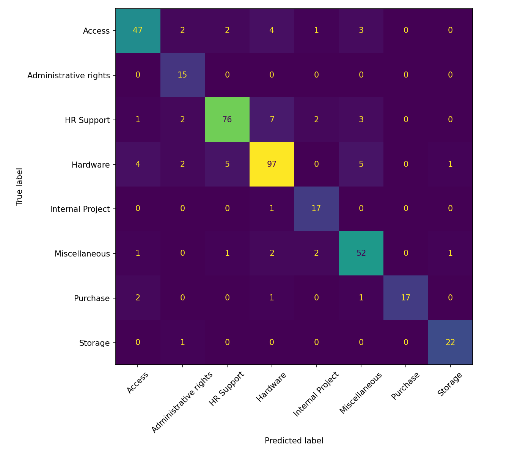
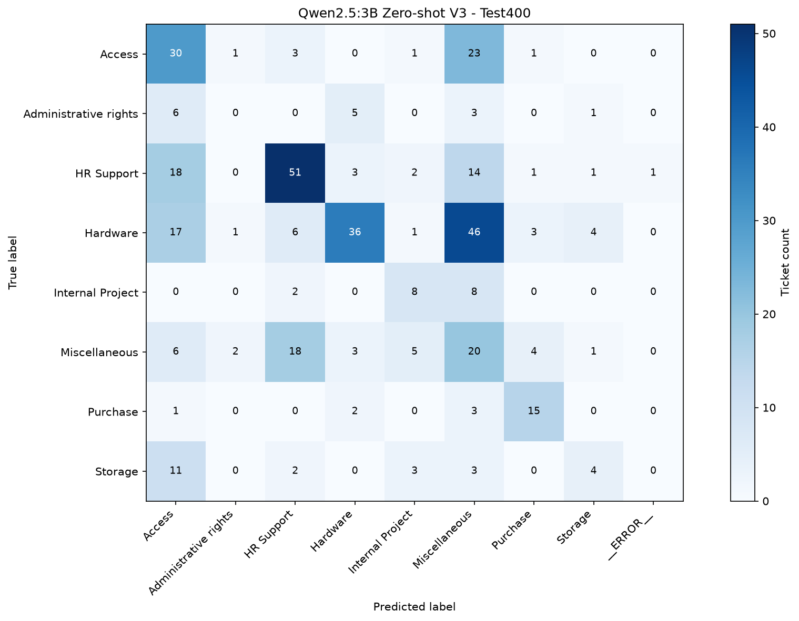

# IT Support Ticket Classification — Machine Learning vs Generative AI

Nghiên cứu và thực nghiệm phân loại phiếu yêu cầu hỗ trợ công nghệ thông tin (IT Support Ticket) bằng hai phương pháp:

- **Machine Learning Baseline:** TF-IDF + Logistic Regression.
- **Generative AI:** Qwen2.5:3B thông qua Ollama, sử dụng Zero-shot Prompt Engineering.

Dự án được thực hiện trong khuôn khổ môn **Cơ sở hệ thống thông tin**, tập trung đánh giá chất lượng phân loại, phân tích lỗi và thảo luận khả năng ứng dụng AI trong quản lý dịch vụ CNTT (IT Service Management — ITSM).

## 1. Cơ sở nghiên cứu

### 1.1. Bài báo tham khảo

**Tên bài báo:** Generative AI Implementation in Enterprises: Lessons From a Case Study of Enhanced IT Service Management.

**Tác giả:** Ashish Jagdish Sharma, Bhawana Rathore, Baidyanath Biswas, Xiao Xiao và Rohit Gupta.

**Năm công bố:** 2026.

**Tạp chí:** Information Systems Journal.

**DOI:** https://doi.org/10.1111/isj.70029

Bài báo nghiên cứu quá trình triển khai Generative AI trong hoạt động quản lý dịch vụ CNTT tại Apollo Tyres Limited.

Các hướng ứng dụng được thảo luận bao gồm quản lý tương tác người dùng, quản lý sự cố, quản lý tài sản CNTT và phân tích dữ liệu vận hành.

### 1.2. Liên hệ với dự án

Nhóm lựa chọn một chức năng có liên quan đến ITSM: tự động phân loại phiếu yêu cầu hỗ trợ dựa trên nội dung văn bản.

Thực nghiệm của nhóm chỉ tập trung vào bài toán phân loại tám nhãn, không nhằm tái tạo toàn bộ hệ thống ITSM hay kết quả vận hành của doanh nghiệp trong bài báo gốc.

## 2. Mục tiêu và câu hỏi nghiên cứu

### 2.1. Mục tiêu

- Xây dựng và đánh giá mô hình phân loại IT Support Ticket.
- Thử nghiệm phương pháp học máy có giám sát và LLM Zero-shot.
- So sánh chất lượng dự đoán trên cùng tập kiểm thử.
- Phân tích các nhãn và trường hợp thường bị phân loại sai.
- Đánh giá thời gian suy luận và thảo luận khả năng áp dụng thực tế.

### 2.2. Câu hỏi nghiên cứu

**RQ1:** Mô hình LLM có thể phân loại các phiếu yêu cầu hỗ trợ CNTT dựa trên mô tả văn bản với hiệu quả như thế nào?

**RQ2:** Hiệu quả phân loại của LLM khác biệt ra sao so với TF-IDF kết hợp Logistic Regression?

**RQ3:** Những loại yêu cầu nào thường bị phân loại sai và những yếu tố nào có thể ảnh hưởng đến kết quả dự đoán?

## 3. Dataset

### 3.1. Các file dữ liệu

Dữ liệu được lưu trong thư mục `data/`:

| File | Vai trò |
|---|---|
| `all_tickets_processed_improved_v3.csv` | Dữ liệu ticket đã qua xử lý |
| `train.csv` | Tập huấn luyện Baseline |
| `test.csv` | Tập kiểm thử đầy đủ |
| `test_sample.csv` | Tập kiểm thử mẫu dùng so sánh hai mô hình |

Quy mô các tập chính:

| Tập dữ liệu | Số ticket |
|---|---:|
| Train | 38.258 |
| Full test | 9.565 |
| Test sample | 400 |

Hai cột quan trọng:

- `Document`: nội dung văn bản của ticket.
- `Topic_group`: nhãn phân loại thực tế.

### 3.2. Các nhãn phân loại

Dự án sử dụng tám nhóm:

1. Hardware
2. HR Support
3. Access
4. Miscellaneous
5. Storage
6. Purchase
7. Internal Project
8. Administrative rights

Phân bố trên tập test400:

| Nhãn | Số ticket |
|---|---:|
| Hardware | 114 |
| HR Support | 91 |
| Access | 59 |
| Miscellaneous | 59 |
| Storage | 23 |
| Purchase | 21 |
| Internal Project | 18 |
| Administrative rights | 15 |
| **Tổng** | **400** |

Các nhãn có số mẫu không cân bằng. Vì vậy, nghiên cứu sử dụng cả Accuracy và Macro F1 để đánh giá.

### 3.3. Kiểm tra dữ liệu

Tập test400 đã được kiểm tra:

- Có đủ 400 ticket thuộc tám nhãn.
- Không thiếu dữ liệu ở hai cột bắt buộc.
- Không phát hiện nội dung trùng khớp chính xác sau chuẩn hóa trong tập test.
- Không phát hiện nội dung trùng khớp chính xác với train.csv, dev80 và validation160 đã kiểm tra.

Việc không phát hiện nội dung trùng khớp chính xác không chứng minh không có ticket gần trùng hoặc cùng chuỗi hội thoại.

Ngoài ra, 10 ticket đầu của test_sample.csv từng được quan sát trong giai đoạn phát triển prompt. Nhóm công bố thêm kết quả trên 390 ticket còn lại để phân tích độ nhạy.

## 4. Phương pháp thực nghiệm

### 4.1. Machine Learning Baseline

Phương pháp do Thành viên 1 phụ trách.

Pipeline:

`Document → TF-IDF → Logistic Regression → Predicted category`

Cấu hình chính:

| Tham số | Giá trị |
|---|---|
| TF-IDF ngram_range | `(1, 2)` |
| min_df | 2 |
| max_features | 50000 |
| sublinear_tf | True |
| Logistic Regression max_iter | 1000 |
| class_weight | `balanced` |

Mô hình được huấn luyện trên train.csv và đánh giá trên test.csv và test_sample.csv.

Chương trình chính: `src/train_baseline.py`.

Mô hình được lưu tại `results/baseline_tfidf_lr.joblib`.

### 4.2. Generative AI / LLM

Phương pháp do Thành viên 2 phụ trách.

Mô hình: **Qwen2.5:3B**, chạy cục bộ thông qua Ollama.

Phương pháp: **Zero-shot Classification**.

LLM nhận nội dung `Document` và danh sách tám nhãn hợp lệ được định nghĩa trước trong prompt, sau đó được yêu cầu trả về một nhãn phù hợp.

Nhãn thật `Topic_group` chỉ được sử dụng để đánh giá kết quả, không được cung cấp cho LLM như đáp án.

Nhóm thực hiện các phiên bản Prompt V1–V5 nhằm nghiên cứu định nghĩa nhãn, quy tắc phân biệt và tác động đến chất lượng dự đoán.

Trong các phiên bản được đánh giá trên validation160, **Prompt V3 đạt Accuracy và Macro F1 cao nhất**, nên được chọn cho lần đánh giá cuối cùng.

Các file chính:

- `src/llm_classifier.py`: Prompt V3 chính thức.
- `src/llm_classifier_v2.py`: Prompt V2.
- `src/llm_classifier_v4.py`: Prompt V4.
- `src/llm_classifier_v5.py`: Prompt V5.
- `src/run_llm_batch.py`: xử lý hàng loạt ticket.

## 5. Kết quả phát triển Prompt

Tập validation160 gồm 160 ticket, cân bằng 20 ticket mỗi nhãn, được sử dụng trong quá trình phát triển prompt.

| Chỉ số | V2 | V3 | V4 | V5 |
|---|---:|---:|---:|---:|
| Accuracy | 44,38% | **48,75%** | 45,00% | 40,00% |
| Macro F1 | 0,4192 | **0,4616** | 0,4317 | 0,4180 |
| HR Support Recall | 20% | **65%** | 25% | 40% |
| Administrative rights Recall | 0% | 0% | 0% | **25%** |

Prompt V5 cải thiện Recall của Administrative rights, nhưng làm giảm hiệu quả tổng thể so với V3.

Phân tích từng ticket cho thấy V5 sửa đúng 13 trường hợp và làm sai 27 trường hợp so với V3. Cả 27 trường hợp suy giảm đều được V5 chuyển thành Miscellaneous.

Các kết quả validation thuộc quá trình phát triển prompt, không được xem là phép đánh giá độc lập cuối cùng.

## 6. Kết quả đánh giá cuối cùng

### 6.1. So sánh trên cùng test400

| Chỉ số | Baseline | LLM V3 |
|---|---:|---:|
| Accuracy | **85,75%** | 41,00% |
| Macro F1 | **0,8611** | 0,3729 |
| Dự đoán đúng | **343/400** | 164/400 |
| Dự đoán hợp lệ | 400/400 | 399/400 |

Baseline vượt LLM 44,75 điểm phần trăm Accuracy và 0,4882 Macro F1.

Kết quả Baseline trên full test gồm 9.565 ticket:

- Accuracy: 85,65%.
- Macro F1: 0,8567.

Không sử dụng kết quả full test của Baseline để so sánh trực tiếp với LLM trên tập 400 ticket.

### 6.2. Kết quả LLM trên 390 ticket

Khi loại 10 ticket đầu từng được quan sát:

- Accuracy: 40,51%.
- Macro F1: 0,3691.

Kết quả này là phép phân tích bổ sung, không được mặc nhiên xem là bằng chứng về một tập test hoàn toàn độc lập.

### 6.3. Recall theo từng nhãn trên test400

| Nhãn | Baseline | LLM V3 |
|---|---:|---:|
| Access | 79,7% | 50,8% |
| Administrative rights | 100,0% | 0,0% |
| HR Support | 83,5% | 56,0% |
| Hardware | 85,1% | 31,6% |
| Internal Project | 94,4% | 44,4% |
| Miscellaneous | 88,1% | 33,9% |
| Purchase | 81,0% | 71,4% |
| Storage | 95,7% | 17,4% |

Baseline có Recall cao hơn ở cả tám nhóm nhãn trong thực nghiệm này.

## 7. Phân tích lỗi

### 7.1. So sánh theo từng ticket

| Trường hợp | Số ticket |
|---|---:|
| Cả hai mô hình cùng đúng | 152 |
| Chỉ Baseline đúng | 191 |
| Chỉ LLM đúng | 12 |
| Cả hai cùng sai | 45 |

LLM dự đoán đúng 12 ticket mà Baseline dự đoán sai. Tuy nhiên, Baseline dự đoán đúng 191 ticket mà LLM sai.

Trong 45 ticket cả hai mô hình cùng sai:

- 18 ticket được hai mô hình dự đoán thành cùng một nhãn sai.
- 27 ticket được dự đoán thành hai nhãn sai khác nhau.

### 7.2. Một số cặp nhãn LLM thường nhầm

| Nhãn thực tế | LLM dự đoán | Số ticket |
|---|---|---:|
| Hardware | Miscellaneous | 46 |
| Access | Miscellaneous | 23 |
| HR Support | Access | 18 |
| Miscellaneous | HR Support | 18 |
| Hardware | Access | 17 |
| HR Support | Miscellaneous | 14 |
| Storage | Access | 11 |

LLM có xu hướng dự đoán nhiều ticket thuộc các nhóm chuyên biệt sang Miscellaneous và Access.

Các nguyên nhân tiềm năng gồm nội dung mơ hồ, nhãn có nghiệp vụ chồng lấn và quy ước gán nhãn đặc thù. Đây là giả thuyết từ phân tích lỗi, chưa phải kết luận nhân quả.

### 7.3. Confusion Matrix

Baseline trên test400:



LLM V3 trên test400:



Confusion Matrix LLM có thêm cột `__ERROR__` để ghi nhận một trường hợp mô hình trả về nhãn ngoài danh sách hợp lệ.

## 8. So sánh thời gian xử lý

| Chỉ số | Baseline | LLM V3 |
|---|---:|---:|
| Thời gian trung bình/ticket | 0,052 ms | 413,6 ms |
| Accuracy | 85,75% | 41,00% |
| Macro F1 | 0,8611 | 0,3729 |

Các thống kê bổ sung của LLM:

- Tổng thời gian đo: 165,440 giây/400 ticket.
- Trung vị: 258,5 ms/ticket.
- P95: 380,1 ms/ticket.
- Ticket đầu tiên: 56,235 giây.
- Trung bình bỏ ticket đầu: 273,7 ms/ticket.
- Nguồn: cột `processing_time_seconds` trong `results/llm_final_predictions_v3_400.csv`. Ticket đầu tiên có thể bao gồm thời gian nạp mô hình của Ollama.

Các phép đo không có quy trình benchmark phần cứng được kiểm soát hoàn toàn giống nhau. Vì vậy, các giá trị thời gian chỉ phản ánh điều kiện thực thi đã ghi nhận.

## 9. Cấu trúc repository

```text
IT-Support-Ticket-Classification/
├── data/
│   ├── all_tickets_processed_improved_v3.csv
│   ├── train.csv
│   ├── test.csv
│   └── test_sample.csv
├── src/
│   ├── train_baseline.py
│   ├── llm_classifier.py
│   ├── llm_classifier_v2.py
│   ├── llm_classifier_v4.py
│   ├── llm_classifier_v5.py
│   ├── run_llm_batch.py
│   ├── evaluate_dev.py
│   ├── check_final_test.py
│   ├── export_baseline_predictions.py
│   ├── compare_baseline_llm.py
│   └── analyze_final_confusion.py
├── results/
│   ├── baseline_report.txt
│   ├── baseline_tfidf_lr.joblib
│   ├── confusion_full.png
│   ├── confusion_sample.png
│   ├── llm_confusion_final_v3_400.png
│   ├── llm_two_week_summary.md
│   └── ... các báo cáo và kết quả phân tích khác
├── requirements.txt
├── .gitignore
└── README.md
```

Danh sách trên chỉ thể hiện các file tiêu biểu, không phải toàn bộ nội dung repository.

## 10. Hướng dẫn cài đặt và sử dụng

### 10.1. Yêu cầu

- Python.
- Các thư viện trong requirements.txt.
- Ollama và mô hình `qwen2.5:3b` nếu cần chạy LLM.
- Dữ liệu trong thư mục data/.

### 10.2. Cài đặt thư viện

Tại thư mục gốc dự án trên Windows PowerShell:

```powershell
py -m pip install -r requirements.txt
```

Kiểm tra môi trường:

```powershell
py -m pip check
```

### 10.3. Chuẩn bị Ollama

Cài đặt Ollama từ https://ollama.com/.

Tải mô hình:

```powershell
ollama pull qwen2.5:3b
```

Đảm bảo dịch vụ Ollama đang chạy trước khi thực hiện phân loại LLM.

### 10.4. Các chương trình chính

Huấn luyện và đánh giá Baseline:

```powershell
py src/train_baseline.py
```

**Lưu ý:** Chương trình trên huấn luyện lại Baseline và ghi lại một số file trong results/. Không chạy nếu muốn giữ nguyên các kết quả đã công bố.

Xuất dự đoán từ mô hình Baseline đã lưu:

```powershell
py src/export_baseline_predictions.py
```

Chương trình này từ chối ghi đè nếu `baseline_predictions_400.csv` đã tồn tại.

Chạy phân loại hàng loạt bằng LLM:

```powershell
py src/run_llm_batch.py
```

Trước khi chạy, cần kiểm tra các cấu hình đầu vào, đầu ra và số ticket trong chương trình. Chương trình hiện được cấu hình cho Prompt V3 và tập test400, có cơ chế tránh ghi đè kết quả đã lưu.

So sánh dự đoán hai mô hình:

```powershell
py src/compare_baseline_llm.py
```

Tạo Confusion Matrix của LLM V3:

```powershell
py src/analyze_final_confusion.py
```

Các chương trình phân tích có thể từ chối chạy nếu file đầu ra đã tồn tại. Khi muốn tái tạo kết quả, cần bảo toàn hoặc sao lưu kết quả cũ trước, không tùy tiện xóa dữ liệu thực nghiệm.

### 10.5. Đọc kết quả mà không chạy lại mô hình

Để xem kết quả đã công bố, ưu tiên đọc:
- **Báo cáo chính:** [`results/final_research_report.md`](results/final_research_report.md) — tổng hợp toàn bộ thực nghiệm trong ba tuần, gồm phương pháp, kết quả, phân tích lỗi và kết luận.
- **Báo cáo Baseline:** `results/baseline_report.txt`.
- **Các báo cáo thực nghiệm chi tiết:** lưu tại thư mục `results/archive/`, gồm:
  - `llm_two_week_summary.md`
  - `baseline_llm_comparison_week3_day1.md`
  - `baseline_llm_shared_errors_week3_day2.md`
  - `baseline_llm_confusion_week3_day3.md`
  - `baseline_llm_efficiency_week3_day4.md`
  - `research_paper_connection_week3_day5.md`

Các báo cáo thực nghiệm gốc khác cũng được giữ lại trong `results/archive/` để phục vụ đối chiếu và kiểm chứng.

Một số file CSV dự đoán chi tiết được lưu ở máy thực nghiệm và có thể chưa được đưa lên GitHub. Quyền chia sẻ nội dung ticket cần được kiểm tra trước khi công bố.

## 11. Phân công công việc

### Thành viên 1 — Machine Learning Baseline

- Chuẩn bị và phân chia dữ liệu.
- Xây dựng TF-IDF + Logistic Regression.
- Huấn luyện và đánh giá Baseline.
- Tạo báo cáo và Confusion Matrix.

### Thành viên 2 — Generative AI / LLM

- Xây dựng bộ phân loại Zero-shot với Qwen2.5:3B.
- Phát triển và so sánh các phiên bản Prompt.
- Phân tích lỗi phân loại.
- Đánh giá LLM trên tập test400.
- So sánh kết quả dự đoán của hai phương pháp.
- Tổng hợp báo cáo thực nghiệm LLM và phân tích liên hệ với nghiên cứu gốc.

## 12. Hạn chế và hướng phát triển

### Hạn chế

- Chỉ thử nghiệm một mô hình LLM Qwen2.5:3B.
- Chưa đánh giá Few-shot hoặc Fine-tuning.
- Một phần dữ liệu test đã được quan sát trong quá trình phát triển prompt.
- Chưa kiểm tra đầy đủ các ticket gần trùng hoặc cùng chuỗi hội thoại.
- Số lượng mẫu theo nhãn không cân bằng.
- Thời gian xử lý của hai phương pháp chưa được đo trong điều kiện benchmark hoàn toàn tương đương.
- Chưa thực hiện thí nghiệm độc lập về mô hình kết hợp.
- Chưa triển khai trong hệ thống ITSM thực tế.

### Hướng phát triển

- Thử nghiệm Few-shot và các LLM khác.
- Nghiên cứu các quy ước gán nhãn đặc thù của dataset.
- Đánh giá khả năng kết hợp Baseline với LLM bằng một cơ chế được thiết kế trước.
- Kiểm tra độ ổn định qua nhiều lần chạy.
- Đánh giá trên dữ liệu ticket mới và trong quy trình nghiệp vụ thực tế.

Các hướng phát triển này chưa phải kết quả thực nghiệm đã đạt được.

## 13. Kết luận

Trong điều kiện thực nghiệm hiện tại, TF-IDF + Logistic Regression đạt kết quả cao hơn rõ rệt so với Qwen2.5:3B Zero-shot Prompt V3 về Accuracy và Macro F1.

Baseline đạt Accuracy 85,75% và Macro F1 0,8611, trong khi LLM đạt Accuracy 41,00% và Macro F1 0,3729 trên cùng tập test400.

Kết quả cho thấy lựa chọn công nghệ trong hệ thống thông tin phải gắn với bài toán, dữ liệu và mục tiêu nghiệp vụ cụ thể.

Thực nghiệm không phủ nhận tiềm năng của Generative AI trong ITSM mà làm rõ những hạn chế của một phương pháp phân loại Zero-shot trong bối cảnh có sẵn dữ liệu huấn luyện có nhãn.

## 14. Tài liệu tham khảo

Sharma, A. J., Rathore, B., Biswas, B., Xiao, X., & Gupta, R. (2026). *Generative AI Implementation in Enterprises: Lessons From a Case Study of Enhanced IT Service Management*. Information Systems Journal. https://doi.org/10.1111/isj.70029