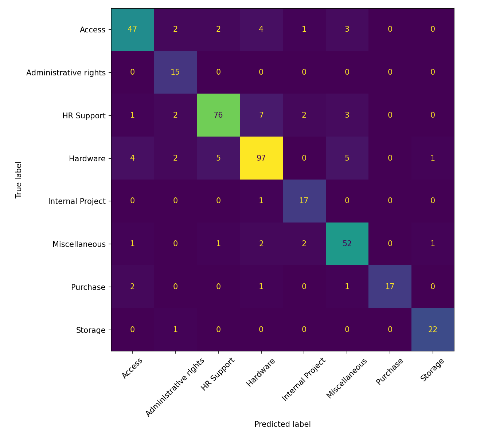
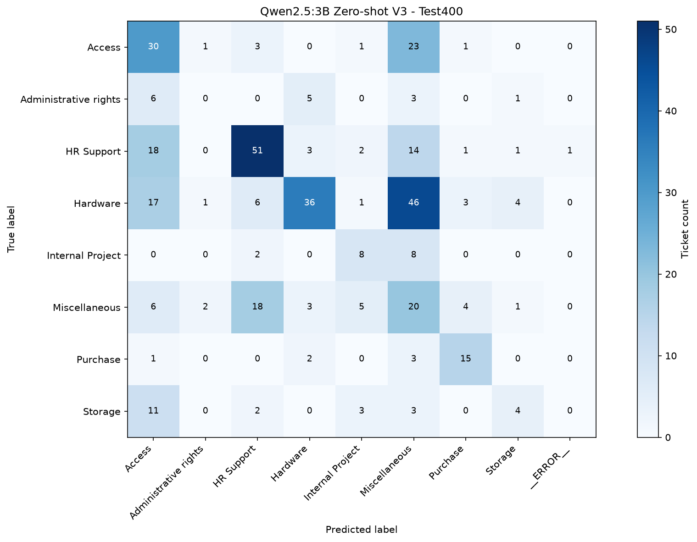

# BÁO CÁO TỔNG HỢP THỰC NGHIỆM

## Phân loại phiếu yêu cầu hỗ trợ CNTT: So sánh TF-IDF + Logistic Regression và Qwen2.5:3B Zero-shot

**Học phần:** Cơ sở hệ thống thông tin  
**Dự án:** `IT-Support-Ticket-Classification`  
**Giai đoạn tổng hợp:** Tuần 1–3  
**Nguồn dữ liệu:** Các kết quả và số liệu đã được nhóm xác nhận trong quá trình thực nghiệm.

---

# Chương 1. Giới thiệu bài toán và cơ sở nghiên cứu

## 1.1. Bối cảnh

Trong quản lý dịch vụ công nghệ thông tin (IT Service Management — ITSM), người dùng gửi phiếu yêu cầu (*ticket*) để báo lỗi hoặc yêu cầu hỗ trợ. Mỗi ticket có thể gồm mô tả ngắn, thư điện tử chuyển tiếp, lịch sử trao đổi và từ vựng nghiệp vụ. Việc phân loại ticket hỗ trợ khâu tiếp nhận, thống kê và chuyển yêu cầu đến nhóm xử lý thích hợp.

Các mô hình học máy có giám sát thường khai thác dữ liệu đã gán nhãn, trong khi mô hình ngôn ngữ lớn (LLM) có thể nhận chỉ dẫn ngôn ngữ tự nhiên và phân loại *zero-shot* mà không cần huấn luyện lại trọng số trên dữ liệu của nhóm. Đề tài kiểm tra mức độ phù hợp của hai phương pháp trong **cùng bài toán tám nhãn**, thay vì mặc định công nghệ mới sẽ vượt trội.

## 1.2. Bài báo nền tảng

Bài báo tham khảo là **“Generative AI Implementation in Enterprises: Lessons From a Case Study of Enhanced IT Service Management”**, của Sharma, Rathore, Biswas, Xiao và Gupta (2026), *Information Systems Journal*. DOI: <https://doi.org/10.1111/isj.70029>.

Bài báo nghiên cứu ứng dụng GenAI trong bối cảnh ITSM tại Apollo Tyres Limited, xem xét các năng lực liên quan đến tương tác với người dùng, quản lý sự cố, tài sản CNTT và phân tích dữ liệu vận hành. Nhóm chọn một nhánh hẹp có thể thực nghiệm độc lập: **phân loại loại yêu cầu từ văn bản ticket**. Đây không phải việc tái hiện toàn bộ hệ thống hay thước đo vận hành của doanh nghiệp trong nghiên cứu gốc.

## 1.3. Phạm vi và sản phẩm

Nhóm xây dựng Baseline TF-IDF + Logistic Regression, xây dựng bộ phân loại bằng Ollama/Qwen2.5:3B Zero-shot, thử nhiều phiên bản prompt, ghi kết quả dự đoán, phân tích lỗi và đối chiếu chất lượng cũng như thời gian xử lý trên tập kiểm thử chung.

---

# Chương 2. Mục tiêu và câu hỏi nghiên cứu

## 2.1. Mục tiêu

1. Xây dựng phương pháp phân loại có giám sát làm mốc đối chiếu.
2. Kiểm tra khả năng phân loại zero-shot của LLM trên tám nhãn cố định.
3. So sánh Accuracy, Macro F1, Recall, Confusion Matrix và thời gian xử lý.
4. Phân tích trường hợp hai phương pháp đúng/sai khác nhau và những khó khăn do ngữ cảnh nghiệp vụ.
5. Liên hệ các phát hiện với quyết định lựa chọn công nghệ trong một hệ thống thông tin.

## 2.2. Câu hỏi nghiên cứu

- **RQ1:** LLM phân loại ticket từ mô tả văn bản hiệu quả đến đâu?
- **RQ2:** Hiệu quả của LLM khác gì so với TF-IDF + Logistic Regression?
- **RQ3:** Loại ticket nào thường bị phân loại sai và yếu tố nào *có thể* ảnh hưởng đến kết quả?

## 2.3. Nguyên tắc đánh giá

Hai mô hình được đối chiếu trên cùng `data/test_sample.csv` (400 dòng), dùng cùng nhãn thật `Topic_group`. LLM chỉ nhận `Document` cùng danh sách nhãn và quy tắc trong prompt, **không nhận nhãn thật của chính ticket**. Các dự đoán lỗi hoặc ngoài danh sách nhãn được tính là sai; không loại bỏ chúng khỏi mẫu số Accuracy.

---

# Chương 3. Dataset, tiền xử lý và phân chia dữ liệu

## 3.1. Các tập dữ liệu

| Tệp | Chức năng | Quy mô đã xác nhận |
|---|---|---:|
| `data/all_tickets_processed_improved_v3.csv` | Dữ liệu sau xử lý, nguồn cho chia tập | Không ghi con số chưa kiểm tra riêng |
| `data/train.csv` | Huấn luyện Baseline | 38.258 |
| `data/test.csv` | Đánh giá Baseline trên tập đầy đủ | 9.565 |
| `data/test_sample.csv` | Đánh giá so sánh Baseline và LLM | 400 |
| `results/llm_dev_sample80.csv` | Phát triển prompt, 10 ticket/nhãn | 80 |
| `results/llm_validation_sample160.csv` | So sánh các prompt trong quá trình phát triển, 20 ticket/nhãn | 160 |

Hai cột chính là `Document` (nội dung) và `Topic_group` (nhãn thực tế). Cấu trúc `Document` có thể chứa những đoạn email hoặc yêu cầu hỗ trợ mang nhiều từ khóa thuộc các nghiệp vụ khác nhau.

## 3.2. Tám nhãn

`Hardware`, `HR Support`, `Access`, `Miscellaneous`, `Storage`, `Purchase`, `Internal Project`, `Administrative rights`.

| Nhãn trong test400 | Số dòng |
|---|---:|
| Hardware | 114 |
| HR Support | 91 |
| Access | 59 |
| Miscellaneous | 59 |
| Storage | 23 |
| Purchase | 21 |
| Internal Project | 18 |
| Administrative rights | 15 |
| **Tổng cộng** | **400** |

Các lớp mất cân bằng nên Macro F1 được báo cáo cùng Accuracy. Các lớp có ít mẫu, đặc biệt Administrative rights (15), cần được diễn giải thận trọng khi suy rộng.

## 3.3. Kiểm tra toàn vẹn và giới hạn độc lập

Chương trình `src/check_final_test.py` đã báo cáo 400 ticket, tám nhãn, không có nội dung trùng chính xác trong tập test sau phép kiểm tra đã lập trình; số nội dung trùng chính xác với `train.csv`, dev80 và validation160 được báo cáo là 0. Điều này **không loại trừ các ticket gần trùng, cùng chuỗi trao đổi hoặc rò rỉ ngữ nghĩa**.

Mười dòng đầu của test400 từng được quan sát khi xây dựng quy tắc Prompt V3. Do đó nhóm báo cáo thêm kết quả sau khi loại mười dòng đầu (390 ticket), nhưng không mô tả phần còn lại như một holdout hoàn toàn độc lập. Các tập dev80/validation160 được rút từ train để phát triển LLM; chúng không phù hợp cho so sánh độc lập với một Baseline đã được huấn luyện trên train.

---

# Chương 4. Phương pháp Baseline: TF-IDF + Logistic Regression

## 4.1. Thiết kế

Thành viên 1 xây dựng pipeline biến đổi văn bản bằng `TfidfVectorizer` rồi phân loại bằng `LogisticRegression`, sử dụng `scikit-learn`. Cấu hình từ `src/train_baseline.py`:

| Thành phần | Thiết lập |
|---|---|
| TF-IDF | `ngram_range=(1, 2)`, `min_df=2`, `max_features=50000`, `sublinear_tf=True` |
| Logistic Regression | `max_iter=1000`, `class_weight="balanced"` |
| Tập huấn luyện | `data/train.csv` |
| Tập đánh giá | `data/test.csv` và `data/test_sample.csv` |
| Mô hình đã lưu | `results/baseline_tfidf_lr.joblib` |

Quy trình không yêu cầu LLM/Ollama để suy luận. `class_weight="balanced"` nhằm điều chỉnh trọng số học theo tần suất lớp.

## 4.2. Kết quả đã tái xác nhận

| Tập | Accuracy | Macro F1 |
|---|---:|---:|
| Full test, 9.565 dòng | 0,8565 | 0,8567 |
| Test400, 400 dòng | 0,8575 | 0,8611 |

Bản `.joblib` của thành viên 1 đã được đối chiếu với dự đoán của bản tái tạo trên 400 ticket: **400/400 nhãn trùng khớp**, 343 dự đoán đúng. Vì vậy không cần huấn luyện lại chỉ để thực hiện phân tích tiếp theo.

## 4.3. Tệp kết quả

`results/baseline_report.txt`, `results/confusion_full.png`, `results/confusion_sample.png` và `results/baseline_tfidf_lr.joblib` (các tệp được Git theo dõi). Tệp `results/baseline_predictions_400.csv` được sinh cho mục đích so sánh chi tiết, trạng thái công bố phụ thuộc quyền chia sẻ nội dung ticket.

---

# Chương 5. Phương pháp LLM: Qwen2.5:3B Zero-shot

## 5.1. Quy trình

Thành viên 2 triển khai mô hình `qwen2.5:3b` thông qua Ollama. `src/llm_classifier.py` chứa **Prompt V3** với các nhãn hợp lệ và quy tắc phân biệt; hàm `classify_ticket(document)` nhận nội dung ticket, trả về đúng một nhãn nếu kết quả hợp lệ. `src/run_llm_batch.py` xử lý lần lượt 400 dòng `data/test_sample.csv` và lưu dự đoán, trạng thái cùng thời gian xử lý vào `results/llm_final_predictions_v3_400.csv`.

Phương pháp là **zero-shot theo nghĩa không fine-tune trọng số LLM bằng dữ liệu ticket của nhóm**. Tuy nhiên, quá trình sửa prompt có quan sát nhiều ticket và kết quả thực nghiệm; vì vậy không đồng nghĩa với việc toàn bộ quy trình đánh giá hoàn toàn chưa tiếp xúc dữ liệu.

## 5.2. Xử lý nhãn lỗi

Một ticket trả về nhãn không thuộc tám lớp hợp lệ, được lưu với trạng thái `error: ValueError`. Trong ma trận nhầm lẫn của LLM, nhóm dùng cột `__ERROR__` bổ sung để bảo toàn **đủ 400 dòng**, thay vì vô tình loại ticket lỗi khi tính biểu đồ.

## 5.3. Khả năng tái sử dụng

Các mã chính gồm `src/llm_classifier.py`, `src/experiments/llm_classifier_v2.py`, `src/experiments/llm_classifier_v4.py`, `src/experiments/llm_classifier_v5.py`, `src/experiments/evaluate_dev.py` và `src/run_llm_batch.py`. Các bản prompt được giữ riêng để bảo tồn lịch sử thay đổi và tránh ghi đè kết quả.

---

# Chương 6. Quá trình phát triển Prompt V2–V5

## 6.1. Giai đoạn dev80

Nhóm tạo tập phát triển 80 dòng cân bằng tám lớp và so sánh những thay đổi về mô tả nhãn cũng như ưu tiên phân loại:

| Chỉ số dev80 | V2 | V3 |
|---|---:|---:|
| Accuracy | 0,4250 | 0,4250 |
| Macro F1 | 0,3908 | 0,3691 |
| HR Support Recall | 0,10 | 0,40 |

Trong 80 dòng, hai phiên bản cùng đúng 27, cùng sai 39; V3 sửa đúng 7 trường hợp và làm sai 7 trường hợp. Vì vậy cải thiện ở một nhãn không bảo đảm cải thiện hiệu quả tổng thể.

## 6.2. Giai đoạn validation160

| Chỉ số | V2 | V3 | V4 | V5 |
|---|---:|---:|---:|---:|
| Accuracy | 0,4438 | **0,4875** | 0,4500 | 0,4000 |
| Macro F1 | 0,4192 | **0,4616** | 0,4317 | 0,4180 |
| HR Support Recall | 0,20 | **0,65** | 0,25 | 0,40 |
| Administrative rights Recall | 0,00 | 0,00 | 0,00 | **0,25** |

Ghi nhận trạng thái xử lý: V2 có 159/160 thành công, V3 có 160/160, V4 có 158/160, V5 có 160/160. Một tệp V4 từng tạo ra dự đoán trùng V3 do sai cấu hình và được giữ riêng dưới tên có hậu tố `duplicate_v3`, **không dùng nó làm kết quả V4 độc lập**.

V3 được chọn cho đánh giá cuối cùng vì có Accuracy và Macro F1 cao nhất trong bốn phiên bản trên validation160, không phải vì tốt nhất ở mọi lớp.

## 6.3. Vì sao V5 không được chọn?

Prompt V5 phát triển từ V3 nhằm bao quát tốt hơn các trường hợp `Administrative rights`, đặc biệt các yêu cầu nâng cấp hoặc cài đặt Windows và những hoạt động triển khai hệ thống. Nghiên cứu dữ liệu train cho thấy nhãn Administrative rights không chỉ chứa từ khóa trực tiếp về quyền quản trị.

Trên validation160, V5 nhận đúng 5/20 Administrative rights, nhưng chỉ đúng 64/160 tổng cộng, thấp hơn 78/160 của V3. So sánh từng ticket: 51 cùng đúng, 69 cùng sai, V5 sửa đúng 13, làm sai 27; tổng cộng 68 dự đoán khác nhau. Các kết quả này gợi ý việc mở rộng định nghĩa nhãn có thể làm thay đổi hành vi phân loại theo hướng bất lợi ở các lớp khác.

## 6.4. Diễn giải phương pháp

Những tập phát triển đã được sử dụng để phân tích và điều chỉnh prompt, nên việc so sánh V2–V5 ở đây là **đánh giá phục vụ lựa chọn thiết kế**, không phải kiểm chứng độc lập cuối cùng. Không dùng kết quả validation160 để đối chiếu trực tiếp với Baseline đã học từ train.

---

# Chương 7. Kết quả đánh giá cuối cùng

## 7.1. Chỉ số trên cùng test400

| Chỉ số | Baseline | LLM V3 |
|---|---:|---:|
| Accuracy | **0,8575** | 0,4100 |
| Macro F1 | **0,8611** | 0,3729 |
| Số dự đoán đúng | **343/400** | 164/400 |
| Dự đoán hợp lệ | 400/400 | 399/400 |

Chênh lệch Accuracy là **44,75 điểm phần trăm**, chênh lệch Macro F1 là **0,4882**. Trong điều kiện nghiên cứu này, Baseline vượt trội rõ rệt. Đây là kết quả của **TF-IDF + Logistic Regression được huấn luyện có giám sát** so với **một LLM nhỏ với prompt zero-shot**; không thể suy rộng thành kết luận mọi LLM đều kém hơn mọi thuật toán truyền thống.

## 7.2. Phép kiểm tra bổ sung trên 390 dòng

Khi loại mười dòng đầu đã từng được xem trong giai đoạn xây dựng prompt: LLM V3 đạt Accuracy **0,4051**, Macro F1 **0,3691**, và có một dòng lỗi. Chỉ số này gần với kết quả 400 dòng nhưng không loại bỏ được mọi nguy cơ thiên lệch do quan sát dữ liệu hoặc lựa chọn prompt.

## 7.3. Kết quả theo lớp

| Nhãn | Support | Baseline đúng | LLM đúng | Baseline Recall | LLM Recall |
|---|---:|---:|---:|---:|---:|
| Access | 59 | 47 | 30 | 0,797 | 0,508 |
| Administrative rights | 15 | 15 | 0 | 1,000 | 0,000 |
| HR Support | 91 | 76 | 51 | 0,835 | 0,560 |
| Hardware | 114 | 97 | 36 | 0,851 | 0,316 |
| Internal Project | 18 | 17 | 8 | 0,944 | 0,444 |
| Miscellaneous | 59 | 52 | 20 | 0,881 | 0,339 |
| Purchase | 21 | 17 | 15 | 0,810 | 0,714 |
| Storage | 23 | 22 | 4 | 0,957 | 0,174 |
| **Tổng** | **400** | **343** | **164** | | |

Baseline có Recall cao hơn ở cả tám nhãn. LLM yếu nhất ở Administrative rights và Storage; chênh lệch nhỏ nhất về Recall nằm ở Purchase.

---

# Chương 8. Confusion Matrix và phân tích lỗi

## 8.1. Hai Confusion Matrix cùng phạm vi

**Baseline — test400:**

**LLM V3 — test400 (có cột lỗi):**

*Lưu ý:* `confusion_full.png` là biểu đồ Baseline trên 9.565 dòng, chỉ dùng để tham khảo khả năng tổng quát trên tập lớn; không đặt cạnh LLM test400 như một phép so sánh cùng tập.

## 8.2. Các cặp nhầm lẫn nổi bật

| Nhãn thực tế → nhãn sai | Baseline trên test400 | LLM V3 trên test400 |
|---|---:|---:|
| Hardware → Miscellaneous | 5 | 46 |
| Access → Miscellaneous | 3 | 23 |
| HR Support → Access | 1 | 18 |
| Miscellaneous → HR Support | 1 | 18 |
| Hardware → Access | 4 | 17 |
| HR Support → Miscellaneous | 3 | 14 |
| Storage → Access | 0 | 11 |

LLM có xu hướng gán nhiều ticket vào các nhãn rộng `Miscellaneous` và `Access`. Đặc biệt, không có ticket Administrative rights nào được LLM phân loại đúng trên test400 (0/15).

## 8.3. So sánh đúng/sai theo từng dòng

| Trường hợp | Số lượng | Tỷ lệ |
|---|---:|---:|
| Cả hai đúng | 152 | 38,00% |
| Chỉ Baseline đúng | 191 | 47,75% |
| Chỉ LLM đúng | 12 | 3,00% |
| Cả hai sai | 45 | 11,25% |
| **Tổng** | **400** | **100%** |

Các phép kiểm tra khớp: Baseline đúng 152 + 191 = 343, LLM đúng 152 + 12 = 164.

Trong 12 ticket chỉ LLM đúng, nhãn thật phân bố thành Access 6, HR Support 3, Hardware 1, Purchase 1, Miscellaneous 1. Đoạn văn bản xem xét có thể liên quan truy cập/mật khẩu, nghỉ phép/timecard hoặc yêu cầu mua thiết bị; vì nhiều ví dụ đã được rút gọn trên Terminal, **không khẳng định nguyên nhân cụ thể của từng lỗi** khi chưa đọc toàn bộ `Document`.

## 8.4. Bốn mươi lăm lỗi chung

Trong 45 ticket mà cả hai cùng sai, **18** trường hợp hai mô hình chọn cùng một nhãn sai, **27** trường hợp chọn hai nhãn sai khác nhau. Phân bố nhãn thật gồm Hardware 16, HR Support 12, Access 6, Miscellaneous 6, Purchase 3, Storage 1, Internal Project 1.

Những số liệu này cho thấy hai mô hình không có cùng toàn bộ tập lỗi. Tuy nhiên, không thể tự động nâng chất lượng bằng cách lấy dự đoán LLM mỗi khi Baseline sai, bởi trong triển khai thực tế **không biết trước nhãn đúng** để chọn.

## 8.5. Nguyên nhân khả dĩ và mức độ chứng cứ

Các giả thuyết từ quan sát lỗi gồm: mô tả ticket ngắn/mơ hồ, lịch sử thư email gây nhiễu, nghiệp vụ chồng lấn, và định nghĩa nhãn nội bộ không trùng nghĩa thông dụng. Nghiên cứu dữ liệu train gợi ý `Administrative rights` có thể bao gồm yêu cầu cài phần mềm, nâng cấp Windows hoặc các tác vụ khác không có từ khóa “admin”. Đây là giả thuyết về vai trò của dữ liệu và quy ước nhãn, không phải chứng minh nguyên nhân nhân quả của từng dự đoán.

---

# Chương 9. So sánh thời gian suy luận

## 9.1. Thống kê quan sát được

| Chỉ số | Baseline | LLM V3 |
|---|---:|---:|
| Thời gian trung bình mỗi ticket | 0,052 ms | 413,6 ms |
| Tổng thời gian cho 400 ticket | ≈ 0,0208 giây (suy ra) | 165,440 giây (ghi nhận) |
| Trung vị | Không được báo cáo | 258,5 ms |
| P95 | Không được báo cáo | 380,1 ms |
| Nhanh nhất / chậm nhất | Không được báo cáo | 209 ms / 56,235 giây |
| Trung bình LLM bỏ lần đầu | — | 273,7 ms |

Dựa trên hai giá trị trung bình đã làm tròn, tỷ số thời gian quan sát được là khoảng **7.954 lần** (413,6 / 0,052); khi bỏ lần gọi đầu của LLM, khoảng **5.263 lần**.

## 9.2. Giới hạn phép đo

Chương trình Baseline đo thời gian gọi `model.predict()` theo lô và chia cho số ticket; thời gian LLM là thời gian từng lời gọi qua Ollama, có thể bao gồm độ trễ lần đầu. Chưa kiểm soát cùng phần cứng/tải máy, chưa đo năng lượng, bộ nhớ, chi phí huấn luyện hay thời gian nạp mô hình một cách độc lập. Vì vậy, đây là **so sánh mô tả thời gian đã ghi nhận**, không phải benchmark chuẩn hóa công bằng tuyệt đối.

## 9.3. Ý nghĩa sử dụng

Trong phạm vi bài toán tám nhãn có dữ liệu huấn luyện, Baseline đồng thời có Accuracy cao hơn và độ trễ dự đoán thấp hơn theo phép đo hiện tại. Việc lựa chọn mô hình cho vận hành vẫn cần xét thay đổi quy ước nhãn, khả năng bảo trì, kiểm tra chất lượng đầu vào và quy trình xử lý các trường hợp không chắc chắn.

---

# Chương 10. Liên hệ nghiên cứu GenAI trong ITSM

## 10.1. Những điểm tương đồng

Cả đề tài và nghiên cứu nền tảng cùng quan tâm đến việc AI hỗ trợ hoạt động ITSM, trong đó phân tích yêu cầu bằng ngôn ngữ tự nhiên có thể hỗ trợ phân loại và điều phối ticket. Đề tài của nhóm cung cấp bằng chứng thực nghiệm chi tiết ở một bước kỹ thuật của quy trình đó.

## 10.2. Khác biệt phạm vi

| Khía cạnh | Nghiên cứu nền tảng | Đề tài của nhóm |
|---|---|---|
| Đơn vị nghiên cứu | Tổ chức/doanh nghiệp và triển khai GenAI trong ITSM | Mô hình phân loại trên dataset |
| Công nghệ | Hệ thống GenAI tích hợp quy trình, công cụ và nhân sự | Pipeline TF-IDF/LR và Qwen2.5:3B Zero-shot |
| Kết quả quan sát | Năng lực và hiệu quả vận hành doanh nghiệp | Accuracy, Macro F1, Recall, lỗi, thời gian dự đoán |
| Suy luận hợp lệ | Bài học triển khai GenAI trong bối cảnh khảo sát | Lựa chọn mô hình cho bài toán tám nhãn đã đánh giá |

Không thể lấy mức cải thiện hiệu quả vận hành của nghiên cứu nền tảng làm chuẩn so sánh với Accuracy trong đề tài nhóm, hoặc coi một kết quả zero-shot thấp là phản chứng cho toàn bộ GenAI trong ITSM.

## 10.3. Bài học về hệ thống thông tin

- **Phù hợp mục đích:** Lựa chọn công nghệ phải xuất phát từ yêu cầu nghiệp vụ và thước đo chất lượng.
- **Chất lượng dữ liệu:** Nhãn nội bộ và cách mô tả nghiệp vụ quyết định nhiều đến hiệu quả phân loại.
- **Quản trị thực nghiệm:** Cần bảo toàn dự đoán, phiên bản prompt và báo cáo lỗi để kiểm toán.
- **Tích hợp con người:** Hệ thống thực tế cần cơ chế phát hiện bất thường, xử lý nhãn ngoài danh sách và chuyển ticket khó cho người phụ trách.
- **Triển khai theo giai đoạn:** Đánh giá mô hình riêng lẻ trước khi thiết kế các giải pháp phối hợp hoặc mở rộng use case.

---

# Chương 11. Hạn chế, kết luận và hướng phát triển

## 11.1. Hạn chế chính

1. Chỉ thử nghiệm một LLM Qwen2.5:3B với zero-shot prompting; không đại diện cho mọi LLM hay các hướng few-shot, fine-tuning, RAG.
2. Prompt đã được phát triển sau khi xem kết quả trên những tập dữ liệu có giới hạn; một số ticket test từng được quan sát.
3. Dev80 và validation160 được lấy từ train, vì vậy không dùng chúng làm tập kiểm chứng độc lập để đối chiếu Baseline đã học trên train.
4. Chưa kiểm tra hết trùng lặp gần và độ tương tự giữa các chuỗi ticket.
5. Một số nhãn có ít mẫu, và các lớp có thể phản ánh quy ước nghiệp vụ đặc thù.
6. Phân tích định tính dựa một phần vào nội dung trích ngắn; cần kiểm tra bản đầy đủ trước khi kết luận nguyên nhân lỗi.
7. Chưa thực hiện kiểm định thống kê có kiểm soát hoặc lặp lại phép đo LLM nhiều lần.
8. Chưa triển khai trực tiếp trong hệ thống ITSM; không đo thời gian giải quyết sự cố hay mức hài lòng của người dùng.

## 11.2. Trả lời RQ1–RQ3

**RQ1:** Qwen2.5:3B Zero-shot Prompt V3 đạt Accuracy 0,4100 và Macro F1 0,3729 trên test400, với một kết quả không hợp lệ. Mô hình thực hiện được chức năng phân loại nhưng chưa đủ độ tin cậy để thay Baseline trong thiết lập này.

**RQ2:** TF-IDF + Logistic Regression đạt Accuracy 0,8575 và Macro F1 0,8611; vượt LLM lần lượt 44,75 điểm phần trăm Accuracy và 0,4882 Macro F1. Baseline cũng có Recall cao hơn trên cả tám nhãn.

**RQ3:** Các nhầm lẫn nổi bật của LLM là Hardware → Miscellaneous, Access → Miscellaneous, HR Support → Access, Storage → Access; các yếu tố có thể liên quan đến mô tả mơ hồ và định nghĩa nghiệp vụ chồng lấn. Những nguyên nhân này cần được kiểm chứng thêm.

## 11.3. Kết luận

Trong bài toán phân loại ticket thành tám nhãn với tập huấn luyện có sẵn, **Baseline TF-IDF + Logistic Regression là lựa chọn phù hợp hơn theo những chỉ số đã đo**. LLM zero-shot có một số trường hợp bổ sung (12 ticket chỉ LLM đúng) nhưng không có lợi thế tổng thể, và có nhiều nhầm lẫn về nhãn rộng hoặc nhãn nội bộ.

Kết quả nhấn mạnh nguyên tắc của môn Cơ sở hệ thống thông tin: thiết kế giải pháp cần cân đối dữ liệu, quy trình nghiệp vụ, chi phí vận hành và các tiêu chí đánh giá thực tế, thay vì chỉ chọn công nghệ mới nhất.

## 11.4. Hướng nghiên cứu tiếp theo

- Đánh giá các LLM và prompt khác trên một tập test mới, thật sự tách biệt.
- Nghiên cứu few-shot/fine-tuning nhưng dùng quy trình phân chia dữ liệu chặt chẽ.
- Thiết kế tiêu chí phát hiện các ticket khó, chuyển cho chuyên viên hoặc LLM hỗ trợ **không dùng nhãn thật khi quyết định**.
- Đo tốc độ trên cùng môi trường, cùng quy trình và nhiều lần chạy.
- Nghiên cứu định nghĩa nhãn, chất lượng dữ liệu, quyền riêng tư và khả năng tích hợp vào ITSM.

---

# Phụ lục A. Các tệp bằng chứng chính

| Nội dung | Tệp hiện tại trong `results/` |
|---|---|
| Báo cáo Baseline | `baseline_report.txt` |
| Mô hình Baseline | `baseline_tfidf_lr.joblib` |
| Biểu đồ Baseline test400 | `confusion_sample.png` |
| Biểu đồ LLM test400 | `llm_confusion_final_v3_400.png` |
| Dự đoán LLM test400 | `llm_final_predictions_v3_400.csv` (có thể chỉ lưu cục bộ) |
| Dự đoán Baseline test400 | `baseline_predictions_400.csv` (có thể chỉ lưu cục bộ) |
| Bảng so sánh theo dòng | `baseline_llm_comparison_400.csv` |

Các đường dẫn ảnh trong báo cáo được viết tương đối với vị trí dự kiến: **`results/final_research_report.md`**. Nếu di chuyển báo cáo sang thư mục khác, cần cập nhật đường dẫn ảnh.

# Phụ lục B. Danh mục 15 báo cáo nguồn cần lưu giữ

Các báo cáo dưới đây ban đầu nằm trực tiếp trong `results/` (danh sách lấy từ kết quả `Get-ChildItem results -Filter *.md` của nhóm). Sau đó chúng được đổi tên và phân nhóm vào `results/archive/`; riêng bản tổng kết hai tuần là `results/llm_summary.md`. Bảng dưới đối chiếu tên gốc với vị trí hiện tại. Đây là các bằng chứng theo giai đoạn, **không nên xóa chỉ vì đã có báo cáo tổng hợp**.

| # | Tên gốc | Vị trí hiện tại |
|---:|---|---|
| 1 | `admin_label_study_week2_day4.md` | `results/archive/2_label_analysis/admin_rights_labels.md` |
| 2 | `baseline_llm_comparison_week3_day1.md` | `results/archive/3_baseline_vs_llm/comparison.md` |
| 3 | `baseline_llm_confusion_week3_day3.md` | `results/archive/3_baseline_vs_llm/confusion.md` |
| 4 | `baseline_llm_efficiency_week3_day4.md` | `results/archive/3_baseline_vs_llm/efficiency.md` |
| 5 | `baseline_llm_shared_errors_week3_day2.md` | `results/archive/3_baseline_vs_llm/shared_errors.md` |
| 6 | `label_analysis_day5.md` | `results/archive/2_label_analysis/label_distribution.md` |
| 7 | `llm_admin_rights_week2_day3.md` | `results/archive/2_label_analysis/admin_rights_errors.md` |
| 8 | `llm_error_analysis_v2.md` | `results/archive/1_prompt_dev/error_analysis_v2.md` |
| 9 | `llm_error_analysis_week2_day1.md` | `results/archive/1_prompt_dev/error_analysis_v1_v2.md` |
| 10 | `llm_two_week_summary.md` | `results/llm_summary.md` |
| 11 | `prompt_comparison_day7.md` | `results/archive/1_prompt_dev/prompt_v2_v3_summary.md` |
| 12 | `prompt_comparison_week2_day2.md` | `results/archive/1_prompt_dev/prompt_v2_v3_v4.md` |
| 13 | `prompt_v3_v5_error_analysis_week2_day6.md` | `results/archive/1_prompt_dev/prompt_v3_v5_errors.md` |
| 14 | `prompt_v5_week2_day5.md` | `results/archive/1_prompt_dev/prompt_v5.md` |
| 15 | `research_paper_connection_week3_day5.md` | `results/archive/3_baseline_vs_llm/paper_connection.md` |

# Tài liệu tham khảo

Sharma, A. J., Rathore, B., Biswas, B., Xiao, X., & Gupta, R. (2026). *Generative AI Implementation in Enterprises: Lessons From a Case Study of Enhanced IT Service Management*. *Information Systems Journal*. <https://doi.org/10.1111/isj.70029>.